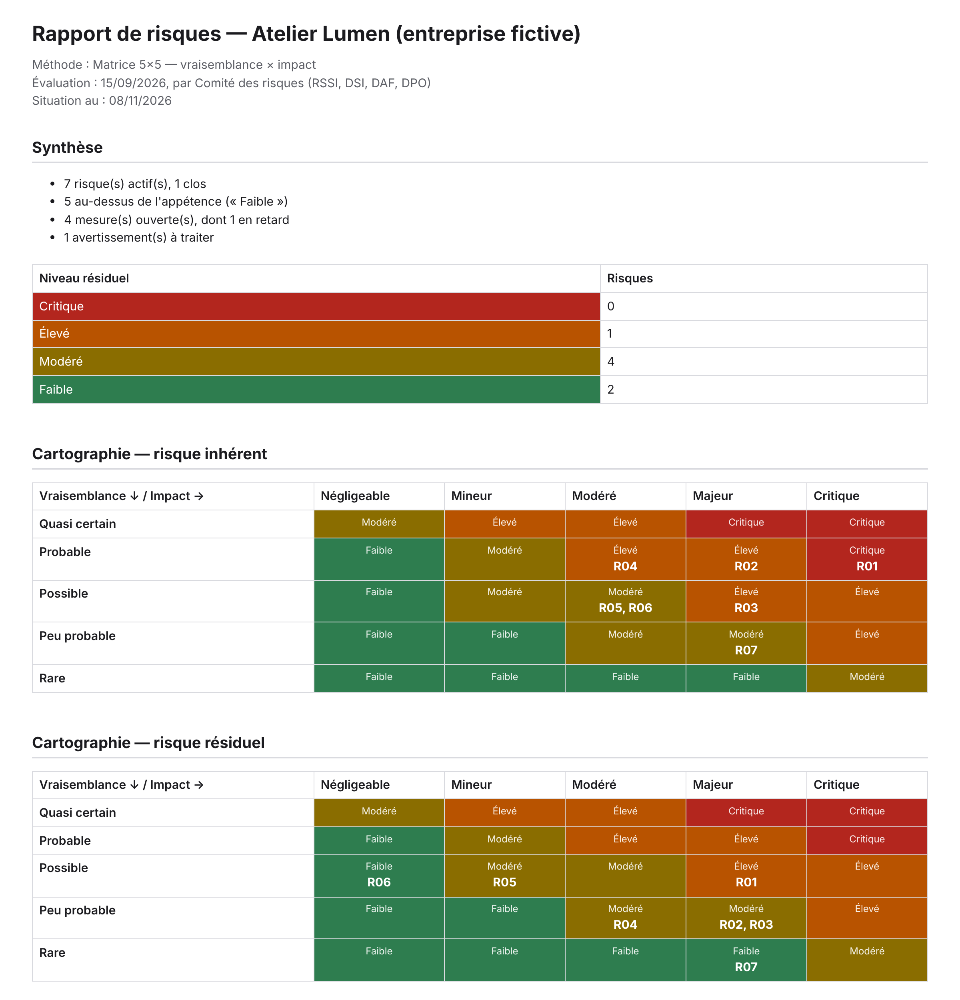
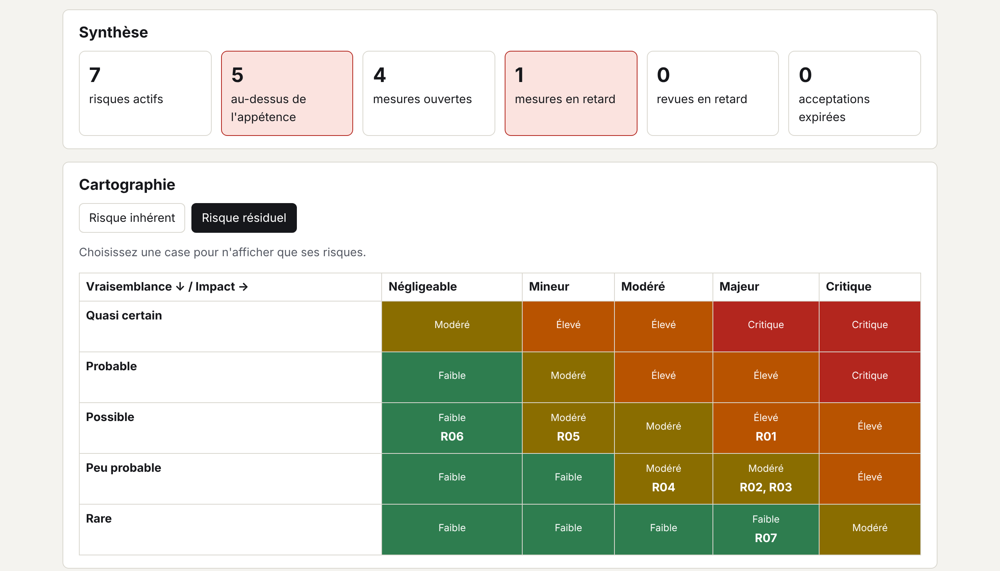
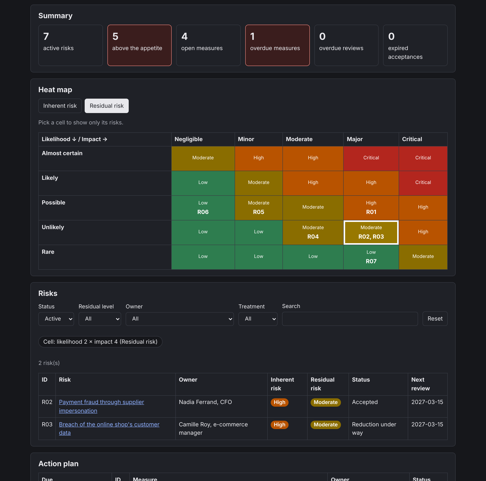

# Matrice d'évaluation des risques

[](https://github.com/Aiyeesha/risk-assessment-matrix/actions/workflows/checks.yml)


🇬🇧 [English version](README.md)

Un **registre de risques méthodique** pour une PME ou une ETI : identifier, analyser, évaluer,
traiter, accepter et revoir chaque risque, selon une méthode écrite et vérifiable. Aligné sur
**ISO/IEC 27005:2022** et sur **EBIOS Risk Manager** (ANSSI, version 1.5 de mars 2024).

> ✅ **Version 1.1.0** : outillage en ligne de commande complet (vérification, import, export,
> rapports), guide d'évaluation, registres d'exemple et [interface web](https://aiyeesha.github.io/risk-assessment-matrix/).



*Rapport HTML généré par `risk-report` à partir du [registre d'exemple](examples/fr/atelier-lumen.toml)
d'Atelier Lumen, entreprise fictive : l'effet des mesures se lit d'une cartographie à l'autre.*

## Contenu du dépôt

| Élément | Contenu |
|---|---|
| **Méthode configurable** | Échelles, seuils et règles d'acceptation décrits dans un fichier TOML vérifié. Deux préréglages : **5×5** (vraisemblance × impact) et **EBIOS RM 4×4** (gravité G1–G4 × vraisemblance V1–V4). |
| **Risque inhérent et résiduel** | Score avant et après les mesures, les deux visibles sur la matrice. |
| **Traitement et acceptation** | Réduire, accepter, transférer ou éviter ; acceptation formelle (qui, quand, pourquoi, jusqu'à quand) lorsque le risque résiduel reste au-dessus de l'appétence. |
| **Revues et historique** | Prochaine revue, revues et mesures en retard, journal des modifications. |
| **Liens** | Actifs, menaces et vulnérabilités, mesures de l'annexe A d'ISO/IEC 27001:2022, techniques MITRE ATT&CK, et playbook de [réponse aux incidents](https://github.com/Aiyeesha/incident-response-playbook) à appliquer si le risque se réalise. |
| **Outils** | `risk-check` (vérification), `risk-report` (rapports Markdown et HTML), `risk-export` et `risk-import` (JSON, CSV protégé contre l'injection de formules), [interface web](#interface-web). |

## Interface web

**[https://aiyeesha.github.io/risk-assessment-matrix/](https://aiyeesha.github.io/risk-assessment-matrix/)** — explorer un registre dans le navigateur, sans rien installer.



- **Chargement** : les registres d'exemple d'Atelier Lumen (5×5 ou EBIOS RM), ou votre propre export
  (`risk-export registre.toml -o registre.json`), **lu dans le navigateur** : rien n'est envoyé ni
  conservé.
- **Synthèse** : risques actifs, au-dessus de l'appétence, mesures ouvertes et en retard, revues en
  retard, acceptations expirées — les échéances sont comparées à la date du jour.
- **Cartographie** du risque inhérent ou résiduel ; un clic sur une case filtre la liste.
- **Liste filtrable** (état, niveau, responsable, traitement, recherche sans accents) et **fiche
  détaillée** de chaque risque, avec ses liens ATT&CK et playbooks.
- **Plan d'action** et **calendrier des revues**, retards en évidence ; français et anglais, thème
  clair ou sombre, utilisable au clavier et sur mobile.



> 🔒 **Un export ouvert n'est pas digne de confiance** : il est entièrement validé avant affichage
> (types, dates, couleurs `#RRVVBB`, niveaux cohérents avec la grille), le texte est inséré avec
> `textContent`, seuls les liens vers attack.mitre.org et le dépôt des playbooks restent des liens,
> et la CSP interdit tout script, style ou requête externe. Seule la langue peut être mémorisée, sur
> demande ; le registre ne l'est jamais.

Développement local (Node.js 24) :

```powershell
cd web
npm ci
npm run typecheck; npm test; npm run build
```

## Guide et exemples

- 📘 **[Guide d'évaluation](docs/fr/guide-evaluation.md)** : la démarche complète, de la préparation
  à la revue, avec les bonnes pratiques et les correspondances ISO/IEC 27001, ISO/IEC 27005 et
  EBIOS RM.
- 🏢 **Registres d'exemple** d'Atelier Lumen, l'entreprise fictive de l'[exercice sur table](https://github.com/Aiyeesha/incident-response-playbook/blob/main/fr/docs/D06-exercice-sur-table.md)
  du dépôt de réponse aux incidents :

| Registre | Méthode | Contenu | Sorties générées |
|---|---|---|---|
| [`atelier-lumen.toml`](examples/fr/atelier-lumen.toml) | 5×5 | 8 risques : rançongiciel, fraude au virement, fuite de données, comptes Microsoft 365, indisponibilité, vol de portable, accès non révoqués, risque clos | [Markdown](examples/fr/atelier-lumen.md) · [HTML](examples/fr/atelier-lumen.html) · [JSON](examples/fr/atelier-lumen.json) |
| [`atelier-lumen-ebios.toml`](examples/fr/atelier-lumen-ebios.toml) | EBIOS RM 4×4 | 4 scénarios stratégiques, dont un risque inacceptable accepté par homologation | [Markdown](examples/fr/atelier-lumen-ebios.md) · [HTML](examples/fr/atelier-lumen-ebios.html) · [JSON](examples/fr/atelier-lumen-ebios.json) |

Les sorties sont générées à une date fixe par `python scripts/build_examples.py` ; la CI vérifie
qu'elles restent à jour.

## Feuille de route

| Étape | Contenu | État |
|---|---|---|
| 1 | Dépôt, structure, vérification de la syntaxe TOML, CI | ✅ |
| 2 | Méthode : format TOML, préréglages 5×5 et EBIOS RM 4×4 | ✅ |
| 3 | Registre : modèle, règles de cohérence, `risk-check` | ✅ |
| 4 | Références (ISO/IEC 27001, ATT&CK, playbooks), import et export CSV sûrs | ✅ |
| 5 | Rapports Markdown et HTML : `risk-report` | ✅ |
| 6 | Guide d'évaluation et registres d'exemple FR/EN → **v1.0.0** | ✅ |
| 7 | Interface web sur GitHub Pages → **v1.1.0** | ✅ |
| 8 | Dépôt public et protections | ⏳ |

## La méthode

Une méthode est un fichier TOML (`kind = "method"`) qui décrit, **en français et en anglais** :

- les deux **axes** : la vraisemblance et l'impact (la « gravité » dans EBIOS RM), de 3 à 7 niveaux
  chacun, numérotés à partir de 1 ;
- les **niveaux de risque**, du moins grave au plus grave, avec leur couleur, leur fréquence de revue
  et ce que l'organisation en fait ;
- la **grille** `[grid]` : le niveau de chaque case, écrit explicitement. Une formule
  « vraisemblance × impact » ne permettrait pas de représenter les zones d'EBIOS RM ;
- l'**appétence** au risque et les **autorités d'acceptation** : qui peut accepter un risque
  au-dessus de l'appétence, et pour combien de mois au plus.

`risk-check` refuse une méthode incohérente et désigne le champ fautif par son chemin
(`grid.rows[4][2] : …`) :

- clés inconnues (une faute de frappe ne passe jamais en silence), textes manquants dans une langue ;
- grille incomplète, niveau inconnu ou jamais utilisé ;
- grille **non monotone** : un risque ne peut pas devenir moins grave quand sa vraisemblance ou son
  impact augmente ;
- un risque plus grave revu moins souvent, ou accepté plus longtemps, qu'un risque moins grave ;
- une autorité d'acceptation manquante (ou inutile) au regard de l'appétence.

### Préréglages

**[`iso27005-5x5`](methods/iso27005-5x5.toml)** — compatible avec la démarche d'ISO/IEC 27005:2022, qui
laisse chaque organisation définir ses échelles. Appétence : *Faible*.

| Vraisemblance ↓ / Impact → | Négligeable | Mineur | Modéré | Majeur | Critique |
|---|---|---|---|---|---|
| Quasi certain | Modéré | Élevé | Élevé | Critique | Critique |
| Probable | Faible | Modéré | Élevé | Élevé | Critique |
| Possible | Faible | Modéré | Modéré | Élevé | Élevé |
| Peu probable | Faible | Faible | Modéré | Modéré | Élevé |
| Rare | Faible | Faible | Faible | Faible | Modéré |

**[`ebios-rm-4x4`](methods/ebios-rm-4x4.toml)** — échelles d'EBIOS Risk Manager (gravité G1 à G4,
vraisemblance V1 à V4) et grille d'acceptation à trois zones. Appétence : *Acceptable en l'état*.

| Vraisemblance ↓ / Gravité → | G1 — Mineure | G2 — Significative | G3 — Grave | G4 — Critique |
|---|---|---|---|---|
| V4 — Quasi certain | Tolérable sous contrôle | Inacceptable | Inacceptable | Inacceptable |
| V3 — Très vraisemblable | Tolérable sous contrôle | Tolérable sous contrôle | Inacceptable | Inacceptable |
| V2 — Vraisemblable | Acceptable en l'état | Tolérable sous contrôle | Tolérable sous contrôle | Inacceptable |
| V1 — Peu vraisemblable | Acceptable en l'état | Acceptable en l'état | Tolérable sous contrôle | Tolérable sous contrôle |

> ⚙️ **À adapter.** Les deux préréglages sont des points de départ réalistes. Copiez-en un, ajustez
> descriptions, grille et autorités à votre organisation, puis faites valider le résultat par la
> direction : la méthode fait partie des critères de risque exigés par ISO/IEC 27001 (6.1.2).

## Le registre

Un registre (`kind = "register"`) désigne sa méthode par son identifiant, puis décrit chaque risque.
Exemple abrégé (un registre complet figure dans [`tests/data/`](tests/data/registre-valide.toml)) :

```toml
kind = "register"
format = 1
method = "iso27005-5x5"         # échelles, grille et autorités viennent de la méthode
lang = "fr"                     # langue des textes, et donc des rôles d'acceptation attendus
organisation = "Atelier Lumen"
assessed_on = 2026-09-01        # dates TOML, sans guillemets
assessor = "Équipe sécurité"

[[risks]]
id = "R02"
title = "Hameçonnage ciblant la comptabilité"
owner = "Directrice administrative et financière"
assets = ["Messagerie", "Virements"]
threat = "Fraudeur se faisant passer pour un fournisseur"
vulnerability = "Changement de RIB sans contre-appel"
gdpr = false                    # données personnelles concernées ?
nis2 = false                    # incident à notifier au titre de NIS 2 ?
inherent = { likelihood = 4, impact = 3 }   # avant les mesures prévues
residual = { likelihood = 2, impact = 3 }   # après
treatment = "reduce"            # reduce, accept, transfer ou avoid
review = { last = 2026-09-15, next = 2027-03-15 }
acceptance = { by = "Claire Martin", role = "Responsable du risque", on = 2026-09-15, until = 2027-09-15, rationale = "…" }

[[risks.measures]]
title = "Contre-appel obligatoire avant tout changement de RIB"
owner = "Directrice administrative et financière"
due = 2026-09-10
status = "done"                 # planned, in-progress ou done
```

Champs facultatifs : `description`, `category`, `existing_controls`, `status` (`active` par défaut,
`closed` pour un risque disparu), `transfer = { to = "…" }`, `residual.justification`, et
`[[risks.history]]` (`on`, `by`, `change`).

`risk-check` distingue deux sortes de messages.

**Erreurs** — le registre est invalide ou incohérent (code de retour `1`) :
- méthode introuvable, note hors des échelles de la méthode, clé inconnue, date mal écrite ;
- risque résiduel supérieur au risque inhérent sans `justification` ;
- `reduce` sans mesure, `transfer` sans destinataire ;
- **acceptation formelle manquante** quand le risque résiduel reste au-dessus de l'appétence et que
  plus rien n'est en cours pour le réduire (traitement `accept`, ou toutes les mesures terminées) —
  c'est l'acceptation des risques résiduels par leurs propriétaires d'ISO/IEC 27001 (6.1.3 f) ;
- acceptation signée par une autre autorité que celle prévue par la méthode, ou plus longue que la
  durée maximale autorisée ;
- prochaine revue plus éloignée que la fréquence du niveau de risque résiduel ;
- historique hors de l'ordre chronologique, dates futures.

**Avertissements** — le fichier est valide, mais une échéance est passée (code `0`, ou `1` avec
`--strict`) : mesure en retard, revue en retard, acceptation expirée. La date de référence est celle
du jour, ou celle donnée par `--today`.

```text
registre.prive.toml: attention : R01.review : revue en retard (prévue le 2027-01-01)
1 fichier(s) vérifié(s) — OK, 1 avertissement(s)
```

## Références

Chaque risque — et chaque mesure, pour l'annexe A — peut renvoyer à trois référentiels :

```toml
iso27001 = ["8.7", "8.13"]    # mesures de l'annexe A d'ISO/IEC 27001:2022
attack = ["T1486", "T1490"]   # techniques MITRE ATT&CK du scénario
playbooks = ["P02"]           # playbook à appliquer si le risque se réalise
```

| Référentiel | Ce que `risk-check` vérifie |
|---|---|
| **ISO/IEC 27001:2022, annexe A** | Le numéro existe : 5.1 à 5.37 (organisationnelles), 6.1 à 6.8 (personnes), 7.1 à 7.14 (physiques), 8.1 à 8.34 (technologiques). Seuls les numéros figurent dans le dépôt : le texte des mesures appartient à l'ISO. |
| **MITRE ATT&CK** | Le format : technique `T1234` ou sous-technique `T1234.001`. L'export y ajoute le lien vers la fiche [attack.mitre.org](https://attack.mitre.org/). |
| **Playbooks** | Le playbook existe parmi P01 à P07 du dépôt [incident-response-playbook](https://github.com/Aiyeesha/incident-response-playbook) ; l'export donne son titre et son lien dans la langue du registre. |

Un identifiant en double dans une même liste est signalé.

> ⚠️ **L'existence d'une technique ATT&CK n'est pas vérifiée.** Le référentiel compte plusieurs
> centaines de techniques et évolue deux fois par an : l'embarquer obligerait à le tenir à jour.
> Seul le format est contrôlé ; vérifiez l'identifiant sur attack.mitre.org.

## Import et export

```powershell
risk-export registre.prive.toml -o registre.json                       # JSON complet (défaut)
risk-export registre.prive.toml --format csv -o risques.csv --measures mesures.csv
risk-import risques.csv --measures mesures.csv -o registre.prive.toml `
    --method iso27005-5x5 --organisation "Atelier Lumen" --assessed-on 2026-09-01 --assessor "Équipe sécurité"
```

- **`risk-export`** n'exporte qu'un registre **valide** (sinon il affiche ses erreurs, code `1`).
  - **JSON** (`schema_version` 1) : registre complet, méthode comprise, avec le niveau de chaque
    note, les liens ATT&CK et playbooks, et les avertissements à la date de référence.
  - **CSV** : un fichier des risques (une ligne par risque, avec les niveaux calculés et le nombre
    de mesures ouvertes) et, avec `--measures`, un fichier des mesures. Séparateur `;` pour un
    registre français (Excel français), `,` pour un registre anglais ; option `--delimiter`.
    Encodage UTF-8 avec BOM, reconnu par Excel. Les listes s'écrivent `Messagerie | Virements`.
- **`risk-import`** crée un registre TOML depuis ces mêmes colonnes : un export modifié dans un
  tableur se réimporte tel quel. Les cellules mal écrites (date, entier, oui/non) sont signalées
  avec leur ligne et rien n'est écrit ; sinon le registre est écrit puis vérifié, et ce qui reste
  à compléter est listé (code `1`). L'historique n'a pas de colonne : il se complète dans le TOML.
- Aucune des deux commandes n'écrase un fichier existant sans `--force`.

> 🛡️ **Injection de formules (CWE-1236).** Un tableur exécute une cellule qui commence par `=`,
> `+`, `-` ou `@`. À l'export, ces cellules sont précédées d'une apostrophe, qui les fait afficher
> comme du texte (recommandation de l'OWASP) ; à l'import, cette apostrophe est retirée et la valeur
> reste un simple texte dans le TOML. Fichiers importés limités à 1 Mio et 5 000 lignes, UTF-8 exigé
> (dans Excel : *Enregistrer sous → CSV UTF-8*).

## Rapports

```powershell
risk-report registre.prive.toml                                 # Markdown sur la sortie standard
risk-report registre.prive.toml --format html -o rapports/rapport.html
```

Le rapport, dans la langue du registre, reprend :

| Section | Contenu |
|---|---|
| **Synthèse** | Risques actifs et clos, risques au-dessus de l'appétence, mesures ouvertes et en retard, avertissements ; nombre de risques par niveau résiduel. |
| **Cartographies** | Deux matrices, risque inhérent puis résiduel : chaque case porte son niveau, sa couleur et les risques qui s'y trouvent — l'effet des mesures se lit d'une matrice à l'autre. |
| **Risques par niveau** | Du plus grave au moins grave, avec responsable, traitement et prochaine revue. |
| **Au-dessus de l'appétence** | Pour chacun : accepté (par qui, jusqu'à quand), acceptation expirée, ou réduction en cours. |
| **Plan d'action** | Mesures ouvertes par échéance, retards en évidence. |
| **Calendrier des revues** | Prochaines revues, retards en évidence. |
| **Références** | Mesures de l'annexe A citées par thème, playbooks et techniques ATT&CK avec les risques concernés (liens). |

Le rapport HTML est **un seul fichier**, imprimable (A4 paysage, couleurs conservées) et lisible en
mode sombre. Il ne contient **aucun script ni aucune ressource externe** : tout texte du registre est
échappé, et sa politique de sécurité du contenu (CSP) n'autorise que sa propre feuille de style,
désignée par son empreinte SHA-256. Les couleurs des niveaux offrent un contraste d'au moins 4,5:1
avec le texte (WCAG 2.2, niveau AA). Le dossier `rapports/` est exclu de Git.

## Utilisation

```powershell
python -m venv .venv
.\.venv\Scripts\Activate.ps1
pip install -e ".[dev]"
risk-check              # vérifie methods/ et examples/
risk-check mon-registre.prive.toml
risk-check --strict --today 2027-01-15   # avertissements bloquants, à une date donnée
pytest -v
```

Les erreurs s'affichent au format `fichier:ligne: message`, reconnu par les éditeurs et la CI.
Code de retour : `0` si tout est valide, `1` en cas d'erreur (ou d'avertissement avec `--strict`),
`2` en cas de mauvais usage. Les méthodes sont lues dans `methods/` (option `--methods` pour un autre dossier).

> 🔒 **Un vrai registre ne se publie pas.** Il décrit les faiblesses de l'organisation. Nommez-le
> `*.prive.toml` ou rangez-le dans `registres-prives/` : ces fichiers sont exclus de Git.

## Licence

[MIT](LICENSE) — © 2026 Aïcha Imène Dahoumane.
